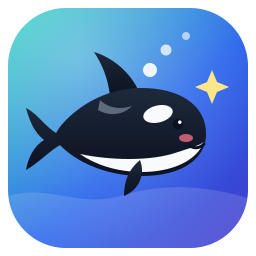
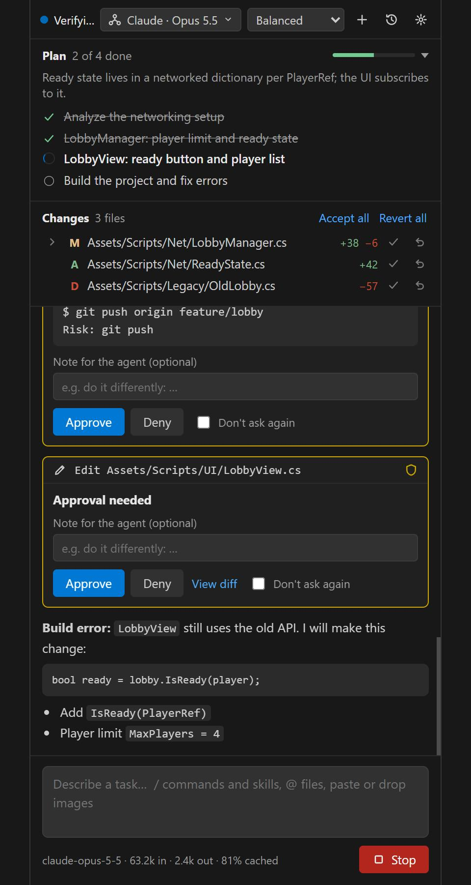
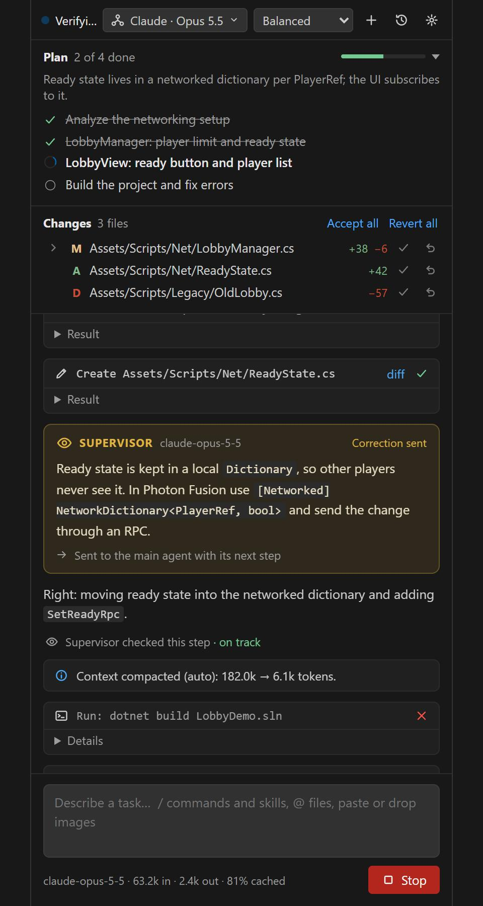
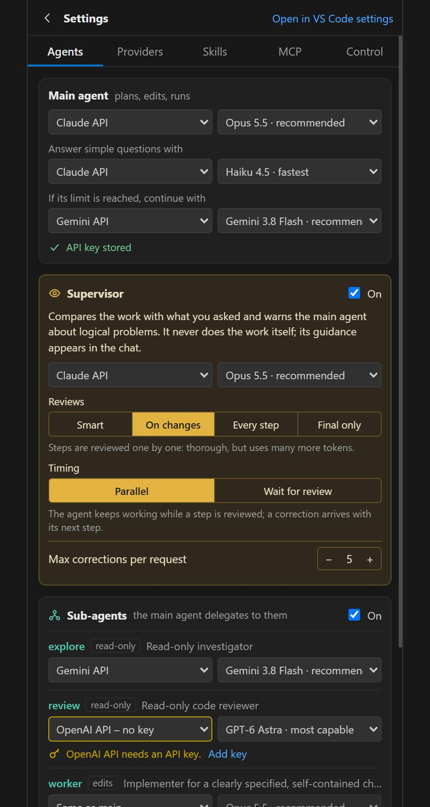

<p align="center"></p>

<h1 align="center">Orka</h1>

<p align="center">
  <b>An AI coding orchestrator: a pod of agents that plans, edits, runs, verifies and reviews your code, with you in control of every risky step.</b>
</p>

<p align="center">
  <a href="https://github.com/12darko/orka/actions/workflows/ci.yml"></a>
  <a href="LICENSE"></a>
  
</p>

Orka uses Claude, GPT, Gemini or any OpenAI-compatible model not as a chatbot that writes code, but as a **decision engine that runs the development loop**:

> Understand → Research → Plan → Implement → Test → Review → Fix → Done

The name comes from *orchestra* and from the orca. Orcas hunt in pods around a leader; in Orka a main agent, its sub-agents and a Supervisor that watches over it work together. The three bubbles in the logo stand for that team.

It runs in three places on one shared core: a **VS Code extension**, the **Orka Desktop** app and the **`orka` CLI**.

<p align="center">
  
  
  
</p>

## Contents

- [Features](#features)
- [Install](#install)
- [Quick start](#quick-start)
- [Agents](#agents)
- [Providers](#providers)
- [Permissions and safety](#permissions-and-safety)
- [Reviewing changes](#reviewing-changes)
- [Hooks](#hooks)
- [Tools: browser, processes, web](#tools-browser-processes-web)
- [Project memory](#project-memory)
- [Skills](#skills)
- [MCP servers](#mcp-servers)
- [Tasks, history and tokens](#tasks-history-and-tokens)
- [Orka CLI](#orka-cli)
- [Orka Desktop](#orka-desktop)
- [Configuration](#configuration)
- [Development](#development)
- [License and disclaimer](#license-and-disclaimer)

## Features

- **A team, not a single bot:** a main agent, a Supervisor that checks its work at key moments, and `explore` / `review` / `worker` sub-agents. Each one can run on its own provider and model.
- **Any model:** Claude API, OpenAI, Gemini, plus OpenRouter, DeepSeek, xAI, Mistral, Groq, Together AI, Ollama, LM Studio or any OpenAI-compatible URL. Model lists are loaded from the provider itself.
- **Sees what it builds:** a headless Chrome/Edge tool that takes screenshots, clicks, types and reads console errors.
- **You stay in control:** *Ask*, *Balanced* and *Autonomous* permission modes; risky commands and writes outside the workspace always ask.
- **Every change is reversible:** per-file and per-hunk revert, inline Keep / Revert in the editor, and snapshots of files changed by terminal commands.
- **Your checks, every time:** hooks run your formatter after each edit and your lint/tests before the agent may say "done"; failures go straight back to the agent.
- **Learns your project:** after a task, lasting lessons (the command that works, a pitfall, a convention) are kept in `.project-ai/lessons.md` for the next task.
- **Skills and MCP:** built-in playbooks (Unity, debugging, testing, security, ...), your own skills, and tools from MCP servers (Unity Editor, Blender, databases, ...).
- **Long tasks that stay cheap:** append-only conversations for prompt caching, a token-friendly Supervisor, compaction with an exact handoff note, a token budget, a light model for simple questions and a fallback model when a provider hits its limit.
- **English and Turkish** UI.

## Install

**VS Code extension (quickest):** download `orka-vscode-<version>.vsix` from the [latest release](https://github.com/12darko/orka/releases/latest), then run **Extensions: Install from VSIX…** in VS Code, or:

```bash
code --install-extension orka-vscode-0.1.0.vsix
```

**Desktop app for Windows:** download `orka-desktop.exe` from the same release and run it; it needs no Node.js, only Edge or Chrome for its window. The file is not code-signed yet, so Windows SmartScreen may ask you to confirm the first start.

**From source** (the CLI, and the desktop app on other systems): you need **Node.js 20+** and **git**. The browser tool and the desktop app use an installed **Chrome or Edge**.

```bash
git clone https://github.com/12darko/orka.git
cd orka
npm install
npm run build
```

**VS Code extension** from source — package it and install the `.vsix`:

```bash
npm run package
```

```bash
code --install-extension packages/vscode-extension/dist/orka-vscode-0.1.0.vsix
```

**Desktop app** — run it, or build the single executable yourself (`packages/desktop/dist/orka-desktop.exe`, or `orka-desktop` on Linux):

```bash
npm run desktop
```

```bash
npm run desktop:exe
```

**CLI** — run it directly, or run `npm link` in `packages/cli` to get an `orka` command everywhere:

```bash
node packages/cli/dist/orka.js
```

## Quick start

1. Open a project folder (VS Code: click the orca in the activity bar; Desktop: **Open folder…**).
2. Add an API key: **Orka: Set API Key**, or set `ANTHROPIC_API_KEY`, `OPENAI_API_KEY` or `GEMINI_API_KEY` in your environment. To use another provider, go to **Settings → Providers → Add a provider**.
3. Pick the main agent's provider and model in the **Agents** menu at the top of the chat.
4. Describe a task, for example *"Add a ready state and a 4-player limit to the lobby"*.

The agent studies the project, proposes a plan, makes the changes, builds and tests, and reports what it changed and how it verified it. File changes show up in the **Changes** panel, where you can keep or revert them.

## Agents

| Role | What it does | Provider / model |
|---|---|---|
| **Main agent** | Understands the task, plans, edits files, runs commands, verifies | Your choice |
| **Supervisor** | Watches the main agent, corrects it when it goes the wrong way, checks the result when it says "done" | Your choice (default: same as main) |
| **explore** sub-agent | Read-only research; reports with file paths and line numbers | Your choice |
| **review** sub-agent | Read-only code review | Your choice |
| **worker** sub-agent | Implements a clearly specified, self-contained change | Your choice |

Pick a provider and model per role from the **Agents** menu in the chat header or **Settings → Agents**.

**Parallel sub-agents.** When the main agent calls several read-only sub-agents (`explore`, `review`) in one turn, they run at the same time (up to 3 by default, `orka.subagents.maxParallel`). `worker`s that write files always run one after another, so two workers never overwrite the same file and two builds never touch the same `obj/` or Unity `Library/` folder at once.

### Supervisor

A separate (usually stronger) model compares the work with what you asked for and warns the main agent about logical problems. It never does the work itself. Its guidance reaches the main agent as a `[Supervisor] …` message and shows up in the chat as an amber card.

**Smart (default, token-friendly):** the Supervisor does not watch every step, only the moments that matter:

| When | What it does |
|---|---|
| The main agent proposes a plan (new or changed) | Checks the plan solves the right problem the right way, before any work starts |
| The main agent is stuck: the last 3 tool calls failed, the same action failed twice, or it keeps repeating itself | Finds the root cause and suggests a way out |
| 12 steps without visible progress (no code changes, no finished plan step) | Checks the direction is still right |
| The main agent asks for advice with `ask_supervisor` | Answers; the advice comes back as the tool's result |
| The main agent says it is done | Checks the result; if it is not convinced, the work continues |

Each check is **a single stateless call**: the Supervisor sees a short brief prepared by the orchestrator, not the whole conversation. The brief contains your requests, the plan, the task's real diff, a one-line summary of recent steps and earlier corrections, so its cost does not grow with the task.

Other modes: *On changes* (every file, command or plan step), *Every step* and *Final only*; step modes can run in *Parallel* (the correction arrives with the next step) or *Wait for review*. Corrections and questions per request are capped (5 by default), and a failing Supervisor never breaks the main task.

## Providers

| Provider | Authentication | How it works |
|---|---|---|
| **Claude API** | API key | Official Anthropic SDK: streaming, adaptive thinking, prompt caching, server-side fallback for declined requests |
| **OpenAI API** | API key | Official SDK with Chat Completions; `baseUrl` can point to any OpenAI-compatible service |
| **Gemini API** | API key / `GEMINI_API_KEY` | Official `@google/genai` SDK; thought signatures are preserved |
| **Added providers** | API key or none | **Settings → Providers → Add a provider**: OpenRouter, DeepSeek, xAI (Grok), Mistral, Groq, Together AI, Ollama, LM Studio, or any OpenAI-compatible URL |
| **Claude Code (local)** | Your Claude Code login | Optional and off by default, see below |

Model pickers group versions by family (e.g. **Opus** 5.5, 5, 4.8 · **GPT-6** Astra, Sol, Luna · **Gemini Flash** 3.8, 3.7, ...). **Load list** fetches the provider's own model list; models Orka does not know yet are added to the right family and marked "new". Lists are refreshed once a day in the background, and **Other…** lets you type any model id. The built-in catalog lives in `packages/core/src/providers/catalog.ts`.

**Default provider:** until you pick one, Orka uses a provider that works right now rather than the Claude API without a key: the first provider that has a key (or Claude Code, if you turned it on).

**Fallback:** Agents panel → main agent → *If its limit is reached, continue with*. When the main provider hits a usage or rate limit, is unreachable or returns a server error, the request continues on the fallback provider with the same conversation (`orka.fallback.provider`, `orka.fallback.model`).

### Claude Code (optional, unofficial)

Orka can use the locally installed [Claude Code](https://docs.anthropic.com/en/docs/claude-code) CLI as a provider, so a logged-in `claude` works without an API key. It is **off by default**; turn it on in **Settings → Providers → Use my local Claude Code CLI as a provider** (`orka.claudeCode.enabled`), or with `"claudeCode": { "enabled": true }` in the CLI config.

> **Please read:** Orka is not affiliated with or endorsed by Anthropic. This option runs *your own* Claude Code login, and it is your responsibility to make sure your use follows [Anthropic's terms](https://www.anthropic.com/legal). Subscription plans are meant for Claude Code itself; for teams, products or anything beyond personal use, connect with a Claude API key.

How it works: each conversation opens one `claude -p --input-format stream-json` process. The CLI's own tools, MCP servers and settings are turned off, and Orka's tools are used through a text protocol. Tool results the model makes up are discarded, and a malformed tool call is sent back once to be rewritten. Updating the CLI automatically (`orka.claudeCode.autoUpdate`) is also off by default.

## Permissions and safety

| | Read | Plan | Edit files | Delete | Command | Risky command* | Git write |
|---|---|---|---|---|---|---|---|
| **Ask** | auto | asks | asks | asks | asks (read-only commands auto) | asks | asks |
| **Balanced** (default) | auto | auto | auto | asks | auto | asks | asks |
| **Autonomous** | auto | auto | auto | auto (reversible) | auto | asks | auto (push/reset ask) |

\* Patterns such as `rm -rf`, `Remove-Item -Recurse`, `git push`, `git reset --hard`, `curl … | sh`, `DROP TABLE`, `npm publish`; encoded PowerShell, `Start-Process -Verb RunAs`, downloads to a file (`-OutFile`, `curl -o`, `wget`, `certutil`, `bitsadmin`), inline scripts that touch files, processes, the network or your home folder (`node -e`, `python -c`, ...), `mshta`/`regsvr32`/`rundll32`, scheduled tasks and services, `setx`, global package installs, `git config --global`, and **commands that write outside the workspace** (absolute paths, `~`, `$env:USERPROFILE`, `..\..\`; temp folders and `/dev/null` excepted). See `packages/core/src/permissions/commandRisk.ts`. Sub-agents follow the same rules.

**What the modes mean:** in *Balanced* and *Autonomous*, the agent runs your project's commands (builds, tests, scripts it writes) without asking; the risky patterns above still ask. That is what makes it fast, and it also means a model following instructions hidden in a web page or file could run project code. **For code or content you do not trust, use *Ask* mode.**

- Each category (file edits, terminal, git, deletes, web) can be overridden in **Settings → Control**. These overrides, the shell, executables, MCP servers, custom providers and API base URLs only come from your own (user) settings: a repository's `.vscode/settings.json` cannot change them. Hooks a folder's settings define run only after you allow them. In VS Code, Orka only runs in trusted workspaces.
- Tool inputs are validated before they run; calls cut off by `max_tokens` and tool results the model made up are never executed.
- Web pages and fetched content are treated as data, not instructions. `web_fetch` and the browser never reach cloud metadata services or link-local addresses (also not through a redirect or a DNS name pointing there).
- Once any agent in a task has read a file that may hold secrets (`.env`, keys and certificates, `credentials`, `appsettings*.json`, Terraform state, service-account files, ...), web access and MCP tools ask for approval for the rest of that task, whatever the mode, so secrets cannot be sent out silently.
- A server's own "read-only" hint does not make its MCP tools approval-free: they follow the terminal rules, and tools marked destructive always ask.
- A repository whose own git config makes git run programs (an `fsmonitor` hook, filters other than Git LFS, diff drivers, includes) is detected: Orka then does not run `git status` on its own, and git commands ask. Orka's own git calls never use fsmonitor, external diff or textconv programs.
- `open_browser` only hands web pages, images, PDFs and text files to the system, never scripts or executables.

## Reviewing changes

- **Changes panel:** every changed file with a diff; keep or revert per file, per hunk (*Revert this part*) or all at once. The agent is told what you reverted.
- **Inline review (VS Code):** added lines are highlighted, removed lines are marked, and each change has **Keep | Revert | Orka change 1/3** above it (`orka.inlineReview`).
- **Terminal commands:** before and after a command that can change files, Orka takes a snapshot of the workspace in a **private git directory** (your own repository is never touched; `node_modules`, `Library`, `obj` and `.gitignore`d files are skipped). Files the command changed, added or deleted (`package-lock.json` from `npm install`, generators, formatters) show up in the Changes panel and can be reverted (`orka.trackCommandChanges`).
- **Editor quick actions:** **Fix with Orka** in the lightbulb menu (Ctrl+.) of an error or warning; **Orka: Explain Selection** and **Orka: Ask About Selection…** in the editor's context menu.

## Hooks

Hooks are your own commands that Orka runs around the agent's work, so your formatter, linter and tests are part of every task:

```json
"orka.hooks": {
  "afterEdit": [{ "command": "npx prettier --write {file}", "match": "*.{ts,tsx,css}" }],
  "beforeFinish": [{ "command": "npm run lint" }, { "command": "npm test", "timeoutSeconds": 600 }]
}
```

- **`afterEdit`** runs after each file an agent edits, for the files its `match` glob(s) select (all files without one). `{file}` becomes the edited file's path. The result goes back to the agent with the tool result, so it sees lint errors right away (and knows a formatter may have changed the file).
- **`beforeFinish`** runs when the main agent is about to finish a request that changed code. If a command fails, its output goes back to the agent with the request to fix it; this repeats at most 3 times. Passing checks count as verification, and files they change (e.g. `eslint --fix`) are revertible like the agent's own changes.
- Hook runs show up in the chat like commands. Desktop: `"hooks"` in its settings file; CLI: `"hooks"` in `~/.orka/config.json`.
- Hooks in a folder's own settings (`.vscode/settings.json`) run commands on your machine, so Orka asks once before using them (and again whenever they change).

## Tools: browser, processes, web

- **`browser`:** opens Chrome or Edge headless. The agent opens a page, **sees the screenshot**, clicks by coordinate or CSS selector, types, presses keys, scrolls, and reads the page text and console errors. Typical loop: `start_process` a dev server → look at it with `browser` → fix → look again. `localhost` and HTML files in the workspace need no approval; external sites need web permission (`orka.browser.path` to pick a browser).
- **`start_process` / `process_output` / `stop_process`:** run dev servers and watchers in the background and wait until they are ready (e.g. `wait_for: "Local:"`). In VS Code each process gets an **"Orka: <name>"** terminal; closing it stops the process.
- **`web_fetch`** reads web pages and documentation; **`open_browser`** opens a URL in your browser or inside VS Code; **`open_file`** shows a file in the editor.
- **`code_outline`** lists classes and methods with line numbers before reading a large file (C#, TypeScript/JavaScript, Python, Go, Java/Kotlin, Rust, C/C++), so the agent only reads the lines it needs.
- At the start of a task the project is scanned (type, build/test commands, file tree, `.project-ai/` notes), and each message carries the editor context: active file, selection, build errors and `git status`.

## Project memory

**Orka: Initialize Project Memory** (or **Settings → Control → Project memory**) creates a `.project-ai/` folder with `project-context.md`, `architecture.md`, `decisions.md` and `conventions.md`. Every task starts by reading it, so the agent does not rediscover your architecture and decisions each time.

**Learning from tasks:** in projects with a `.project-ai/` folder, after a request that changed code the agent is asked for at most 3 lasting, project-specific lessons: the build or test command that works, a pitfall and how to avoid it, a convention you confirmed. New ones are added to `.project-ai/lessons.md` (duplicates are skipped, your own notes stay, the newest 60 are kept) and show up in the Changes panel like any other change. The question and answer are appended to the conversation, so the prompt cache stays valid. Turn it off with `orka.memory.learn` (CLI: `"memory": { "learn": false }`).

## Skills

Skills are ready-made expert playbooks for specific kinds of work. They are **global**: the same skills are available in every project and in all three apps.

- **Built in:** `unity`, `debugging`, `testing`, `code-review`, `refactoring`, `git-workflow`, `security`, `performance`, `documentation`, `new-project`, `frontend` (`packages/core/skills/`).
- **Your own:** in `~/.orka/skills/`, either a single file (`name.md`) or a folder with extra files (`name/SKILL.md`). A file with the same name as a built-in skill replaces it.
- **Format:** `name` and `description` front matter on top (the agent decides when to use a skill from its description), Markdown instructions below.
- **Use:** the skill list is part of the system prompt and the agent loads a skill with `load_skill` when a task fits. You can also add one directly: `/unity make a player controller`.
- **Settings → Skills:** turn skills on or off, open them, **Customize** a built-in skill into your own folder, or start a **New skill**.

## MCP servers

Agents can use tools from MCP (Model Context Protocol) servers: Unity Editor, Blender, databases, browsers… **Settings → MCP**:

- **Import from Claude Code:** brings the MCP servers from `~/.claude.json` (global and this project's) into Orka in one click.
- **Edit the list:** `orka.mcpServers`, each entry either `{"command": "uvx", "args": ["blender-mcp"]}` (stdio) or `{"url": "http://localhost:8080/mcp"}` (Streamable HTTP).
- A project's **`.mcp.json`** (Claude Code format) is used too; because it starts programs on your machine, Orka asks the first time.
- Servers start when a task needs them and stay up between tasks. Their state (ready · N tools / error / off) is shown, and each one can be turned on or off. Tools are named `mcp__<server>__<tool>` and follow the terminal rules; read-only sub-agents only see tools their server marks read-only.

## Tasks, history and tokens

- **History:** every request is saved with its task. Open an earlier task from **History** and **continue where you left off**: the conversation, the frozen system prompt and the tool list come back exactly. Unaccepted file changes are kept as checkpoints, so they can still be reverted later.
- **Compact:** when a request's prompt passes a threshold (150k tokens by default) or you type `/compact`, the conversation is reduced to one handoff message. Orka does not trust the model's summary alone; it adds its own exact record of your requests (verbatim), the plan, changed files with +/− lines, the Supervisor's open corrections and the latest tool results.
- **Usage:** calls and input / output / cache tokens per role (main, Supervisor, each sub-agent). Click the token line under the chat for the **Usage** panel. Claude API costs are estimated from list prices; for other providers add your own prices (USD per million tokens, `*` wildcards, the most specific match wins):

  ```json
  "orka.pricing": {
    "openai/gpt-6-*": { "input": 3, "output": 12 },
    "custom:openrouter/*": { "input": 1, "output": 4, "cacheRead": 0.1 }
  }
  ```

- **Token budget:** `orka.tokenBudget` caps the new tokens (input + output + cache writes) a request may spend across all agents. When it is reached the agent pauses; type "continue" to go on with a fresh budget. 0 = no limit.
- **Light model:** Agents panel → *Answer simple questions with* (e.g. Claude Haiku). Short questions that need no changes go to the lighter model; if the request turns out to need a change, the main model takes over with the same conversation.
- **Images:** paste (Ctrl+V) or drop up to 5 images per message; large images are downscaled before sending.
- **Hand off to Freebuff:** [Freebuff](https://freebuff.com) is a free, ad-supported terminal agent without an API, so Orka hands a task over instead of calling it: **Agents → Other agents → Continue in Freebuff** (or `/freebuff` in the CLI). Orka snapshots the workspace, copies a task summary to the clipboard and opens Freebuff in a terminal; afterwards, the files Freebuff changed show up in the Changes panel.

**Chat box:** `/new`, `/compact`, `/history`, `/review [focus]`, `/plan <task>`, `/explore <question>`, `/agents`, `/skills`, `/usage`, `/settings`, `/help`, and `/<skill> <request>`. Type `@` to attach a file.

## Orka CLI

The same core in the terminal: chat, Supervisor, sub-agents, Skills, MCP, permissions, `/diff` and `/undo`, task history.

- `orka` starts a session; `orka "fix the login bug"` starts with a request.
- `orka -p "explain main.ts"` answers one request and exits; the reply goes to stdout and progress to stderr, so it works in scripts.
- `orka -c` continues the last task in this folder; `orka models`, `orka config`.
- Options: `--provider`, `-m/--model`, `--mode ask|balanced|autonomous`, `-y` (autonomous), `--supervisor claude:claude-sonnet-5-5`, `--no-supervisor`, `-C <folder>`, `--lang en|tr`.
- In a session: `/help`, `/new`, `/diff`, `/undo`, `/compact`, `/mode`, `/model`, `/usage`, `/skills`, `/<skill> <request>`, `/freebuff`, `/exit`; `@file` attaches a file or image; Ctrl+C stops the running request.
- Approvals are asked in the terminal (`y` yes · `a` always · `n` no · `d` diff · or type what to do instead). Without a terminal (piped input), anything that needs approval is **declined**, never approved silently.
- **API keys are read from environment variables only** (`ANTHROPIC_API_KEY`, `OPENAI_API_KEY`, `GEMINI_API_KEY`, and `apiKeyEnv` for custom endpoints); they are never written to the config.

## Orka Desktop

Orka in its own window, without VS Code: the same chat, Agents panel, settings, Skills, MCP, history, diffs and approvals.

- Open a project with **Open folder…** (recent folders are listed), or start with a folder: `orka-desktop.exe D:\Projects\Game` (from source: `node packages/desktop/dist/orka-desktop.js D:\Projects\Game`).
- `orka-desktop.exe` is a single file with Node.js built in; on first start it unpacks its UI files to `~/.orka/desktop/runtime/`.
- The window is Edge or Chrome in **app mode** (no tabs or address bar, a separate profile), so there is no extra Electron download. Closing the window quits Orka.
- The UI is served by a local server bound to `127.0.0.1` on a random port, with a per-window secret cookie (the window gets it through a one-time start link, so the browser's command line holds nothing reusable); requests with another host name (DNS rebinding) or not coming from the page itself are rejected, and a strict CSP blocks external scripts and images.
- **API keys are kept in the operating system's protected storage:** DPAPI on Windows (only your user account can decrypt them), Keychain on macOS, Secret Service on Linux.
- Task history and snapshots are shared with the CLI (`~/.orka/tasks`), so `orka -c` can continue a task started in Desktop.

## Configuration

| App | Where settings live |
|---|---|
| VS Code | `orka.*` in VS Code settings, or the extension's own **Settings** screen (gear icon in the chat) |
| Desktop | `~/.orka/desktop/settings.json` (same keys without the `orka.` prefix; edits apply immediately) |
| CLI | `~/.orka/config.json` (`orka config` prints an example) |

Example CLI config:

```json
{
  "provider": "claude",
  "model": "claude-opus-5-5",
  "mode": "balanced",
  "supervisor": { "enabled": true, "model": "claude-sonnet-5-5", "frequency": "checkpoints" },
  "light": { "provider": "claude", "model": "claude-haiku-4-5" },
  "fallback": { "provider": "gemini", "model": "gemini-3.8-flash" },
  "custom": [{ "id": "ollama", "label": "Ollama", "baseURL": "http://localhost:11434/v1", "model": "qwen3-coder" }],
  "hooks": { "beforeFinish": [{ "command": "npm test" }] },
  "memory": { "learn": true },
  "claudeCode": { "enabled": false }
}
```

**Language:** `orka.language` is `auto`, `en` or `tr`. On `auto`, the VS Code display language (if a language pack is installed) or the operating system's language is used. Prompts to the models are always in English; the agent replies in the language you write in.

## Development

```bash
npm install
npm run build
npm run typecheck
npm test
```

- `npm test` runs the core tests and the end-to-end tests of the CLI and the desktop app (against fake model servers and a real headless Chrome/Edge).
- `npm run test:e2e -w orka-vscode` runs the extension in an isolated VS Code instance against a fake Claude API.
- `npm run preview -w @orka/app` opens the chat UI with a sample session at <http://localhost:5178> (`?light`, `?empty`, `?tr`, `?nocc`, `?settings=skills`).
- In VS Code, **F5** (*Run Extension*) starts a development window.

```
packages/
├── core/                # @orka/core: editor-agnostic engine
│   ├── skills/          # Built-in skills (Markdown)
│   └── src/
│       ├── orchestrator/  # Agent loop, events, sub-agent runner
│       ├── supervisor/    # Supervisor: checkpoints, reviews, interventions
│       ├── agents/        # Sub-agent profiles (explore, review, worker)
│       ├── providers/     # Claude API, OpenAI, Gemini, Claude Code, text tool protocol
│       ├── tools/         # File, search, terminal, git, plan, web, browser tools
│       ├── permissions/   # Permission manager, command risk classifier
│       ├── context/       # Project scan, system prompt, per-turn context
│       ├── changes/       # Line diff, hunks, accept / revert, checkpoints, ShadowGit
│       ├── browser/       # Headless Chrome/Edge (DevTools protocol)
│       ├── mcp/           # MCP client (stdio + Streamable HTTP) and manager
│       ├── skills/        # Skill loader, load_skill tool
│       ├── i18n/          # t() and dictionaries (tr)
│       ├── usage/         # Cost estimates, user price table
│       └── persistence/   # Task history
├── app/                 # @orka/app: chat UI + AppController shared by VS Code and Desktop
├── vscode-extension/    # VS Code shell: settings, secrets, diffs, inline review
├── desktop/             # Desktop shell: local server, OS key store, dialogs
└── cli/                 # The orka command
```

**Extending Orka:**

- **A new API provider:** implement `AIProvider`, then add it to `PROVIDERS` and `createProvider` in `providers/index.ts`.
- **A new local CLI** (e.g. Gemini CLI): follow `ClaudeCodeProvider`; `textToolProtocol` already handles tool calls, made-up results and stream filtering.
- **A new sub-agent:** add a profile to `agents/subagents.ts` (name, description, read-only or full access, role instructions).
- **A new app** (e.g. a JetBrains plugin): implement `AppShell` (settings, dialogs, key store, messages to the UI) and start an `AppController` with it; the chat UI in `packages/app/webview` works as is.

**Design decisions:** the conversation is append-only during a task (fixed system prompt and tool list) so prompt caching keeps working and Claude's thinking blocks stay valid; provider-specific content (thinking blocks, Gemini thought signatures) is sent back untouched; risky actions always need approval, for sub-agents too.

See [CONTRIBUTING.md](CONTRIBUTING.md) to get involved and [CHANGELOG.md](CHANGELOG.md) for releases.

## License and disclaimer

Orka is developed by **Enophia Software**, part of Enophia Studio, and released as open source under the [MIT License](LICENSE).

Orka is an independent project and is not affiliated with, endorsed by or sponsored by Anthropic, OpenAI, Google or any other model provider. Claude, GPT, Gemini and other names are trademarks of their respective owners. You are responsible for your use of each provider and for following its terms. AI agents can make mistakes: review changes before you keep them, and be careful with the *Autonomous* mode.

To report a security problem, see [SECURITY.md](SECURITY.md).
